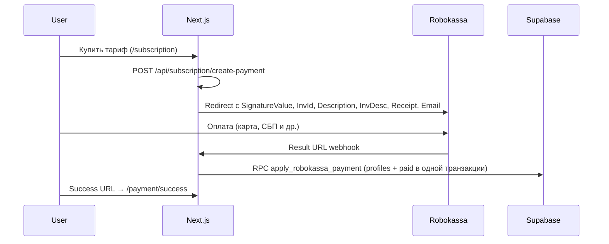

# API: подписка Pro / Pro+ и Robokassa

## Поток оплаты

## Endpoint'ы

### `POST /api/subscription/create-payment`

- Auth: сессия Supabase, `profile_id` из `profiles` по `auth_user_id`.
- Тело: `{ plan: "pro" | "pro_plus", period: "monthly" | "yearly" }`.
- Ответ: `{ paymentUrl: string, invId: number }`.
- Ссылка Robokassa: [`create-payment/route.ts`](../../../my-app/src/app/api/subscription/create-payment/route.ts).

### `POST /api/subscription/create-upgrade-payment`

- Апгрейд Pro → Pro+ с пропорциональной доплатой.
- Описание платежа: «Тариф Pro+».

### `POST /api/subscription/webhook` (Result URL)

- Проверка подписи Robokassa (Password2).
- Активация через RPC `apply_robokassa_payment(inv_id)` — одна транзакция: сначала `profiles`, затем `subscription_payments.status = paid`.
- Идемпотентность: повтор webhook при уже `paid` **догоняет** профиль, если подписка не активирована (`repaired`), иначе `already_paid` → `OK{InvId}`.
- SQL: [`2026-09-16-apply-robokassa-payment.sql`](../../../my-app/supabase/sql/2026-09-16-apply-robokassa-payment.sql).
- **Обязательно на prod:** RPC должна быть накатана через [`deploy-app.sh`](../../../my-app/deploy/timeweb/deploy-app.sh) (`apply-robokassa-payment`). Без неё webhook отвечает `500 DB error`, Success URL у пользователя всё равно открывается, но тариф не активируется.

## Описание платежа (Description / InvDesc)

Тексты задаются в [`subscriptionPlans.ts`](../../../my-app/src/lib/subscriptionPlans.ts):

| Тариф | Текст в Robokassa и СБП |
|-------|-------------------------|
| Pro (месяц / год) | `Тариф Pro` |
| Pro+ (месяц / год) | `Тариф Pro+` |
| Апгрейд Pro → Pro+ | `Тариф Pro+` |

В URL передаются оба параметра — `Description` (актуальный API) и `InvDesc` (legacy / СБП) — плюс `Encoding=utf-8` для кириллицы. Хелпер: `applyRobokassaInvoiceDescription` в [`robokassa.ts`](../../../my-app/src/lib/robokassa.ts).

Подпись `SignatureValue` **не** включает Description / InvDesc / Email.

С Receipt: `MerchantLogin:OutSum:InvId:Receipt:Password1`, где `Receipt` — URL-encoded JSON.

## Фискальный чек (Receipt, 54-ФЗ)

Без параметра `Receipt` Robokassa формирует чек «Свободная продажа» — это ошибка фискализации и чек не уходит на почту.

Номенклатура передаётся в [`robokassa.ts`](../../../my-app/src/lib/robokassa.ts) через `buildRobokassaReceipt` + `encodeRobokassaReceipt`.

| Тариф | `Description` / `InvDesc` (СБП) | `Receipt.items[0].name` |
|-------|----------------------------------|-------------------------|
| Pro месяц | `Тариф Pro` | `Подписка Pro на 30 дней` |
| Pro год | `Тариф Pro` | `Подписка Pro на 365 дней` |
| Pro+ месяц | `Тариф Pro+` | `Подписка Pro+ на 30 дней` |
| Pro+ год | `Тариф Pro+` | `Подписка Pro+ на 365 дней` |
| Апгрейд Pro → Pro+ | `Тариф Pro+` | `Доплата за переход на тариф Pro+` |

Поля позиции: `quantity: 1`, `sum = OutSum`, `tax: "none"`, `payment_object: "service"`, `payment_method: "full_payment"`.

`Email` берётся из `user.email` Supabase — Robokassa отправляет чек на этот адрес (не входит в подпись).

## Переменные окружения

| Переменная | Где | Назначение |
|------------|-----|------------|
| `NEXT_PUBLIC_ROBOKASSA_MERCHANT_LOGIN` | build (клиент) | Логин магазина |
| `ROBOKASSA_PASSWORD1` | server only | Подпись исходящего платежа |
| `ROBOKASSA_PASSWORD2` | server only | Проверка Result URL |
| `ROBOKASSA_SNO` | server | СНО для чека (`usn_income` по умолчанию) |
| `ROBOKASSA_TEST_MODE` | server | `1` для тестового контура |
| `ROBOKASSA_TEST_PASSWORD1/2` | server | Пароли тестового контура |

Пример: [`deploy/timeweb/.env.app.example`](../../../my-app/deploy/timeweb/.env.app.example).

## RLS и безопасность

- Клиент **не должен** сам выставлять `is_pro = true` — только webhook с `service_role`.
- См. [`features/subscription-pro.md`](../features/subscription-pro.md), [`features/subscription-paid-access.md`](../features/subscription-paid-access.md).
